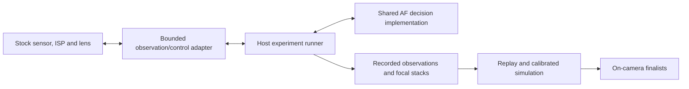

# Autofocus research and implementation

## 11. Autofocus research and implementation work package

### 11.0 Stock-first, sensor-backed iteration

The process prioritizes measured AF gains, short host iterations, minimal owner attention, no specialized photography equipment, and protection against persistent damage. Start with static AF-S and one intended region on the observed body and Viltrox AF 28mm F4.5 firmware 1.05. The lens has a fixed aperture and no manual-focus ring.

Keep the real sensor, ISP and lens under stock firmware control. Export coherent observations, evaluate decision policies on the host, then run finalists on-camera. The full-system emulator checks firmware integration; it is not a prerequisite for every algorithm experiment or a physical timing oracle.

This is a design, not an implemented live bridge. Ordinary-boot RAM reads and cardless shooting-screen operation have hardware evidence in the [bulk-read report](../reports/ff80-bulk-read.md). Coherent image/statistic export, useful AF with USB attached, and closed-loop host control require their own observations. A buffer catalogue does not establish active ownership or physical backing.

| Stage | First useful result | Advancement boundary |
| --- | --- | --- |
| Existing stock observations | Same-boot message trace after ordinary AF; a fresh preview/statistic sample where safely readable | Establish AF operation with the ordinary USB route, extraction validity and observation overhead. No new hook merely to duplicate an existing signal. |
| Coherent snapshot adapter | Small AF-statistic records and intended-region crops with acquisition provenance | Meet the [snapshot and session contract](08-artifact-and-runtime-contracts.md#camera-snapshots-and-live-experiment-sessions); review new mechanism bytes before live use. |
| Automated measurement | Bounded starts, reference sweeps and paired batches with machine-generated records | Use validated stock lens operations, measured safe bounds, explicit cancellation and a finite session envelope. |
| Host candidate search | Recorded-path reproduction, calibrated counterfactual experiments and live optical feedback | Keep origins distinct, reject unsupported observations/configurations and validate candidate ranking against held-out body observations. |
| On-camera comparison | Shared controller runs locally without a host in the control path | Meet [speed, quality, accuracy and operational acceptance](06-benchmarks.md); bulk extraction stays outside timed acquisitions. |

Prefer AF statistics plus unoverlaid preview crops over continuous full-resolution raw transfer. Measure per-request latency and contention, not just aggregate USB throughput. Larger reference images may be exported between attempts. Raw sensor, post-ISP preview, AF statistics and composited display pixels are different domains.

Cardless preview/statistic research does not wait for SD repair. The broken slot removes a recovery route and ordinary save/playback acceptance; disclose that limitation in every affected run proposal. If preview cannot support independent quality, investigate bounded capture-to-RAM with fresh exposure, classified output, buffer release and normal preview restoration. Bypassing a no-card check or pretending a storage write succeeded is not a capture implementation. Service imaging jobs remain separate unproved candidates, with their adjacent storage hazards.

Use one load per approved session where practical, with bounded policy/configuration selection at idle. Do not assume safe hot unload or checkpoint restoration on the body. Keep firmware, calibration and boot writes off the AF iteration path; temporary parameter overrides belong in owned RAM, not adjustment caches that stock code may later persist. RAM code is privileged, not sandboxed. Authorization and session endings remain owned by [the camera-run procedure](07-governance-and-handoff.md#3-camera-runs).

The owner supplies a stable household scene, identifies the intended subject, confirms the scoped run, makes a few scene changes and performs the exit check. The agent handles commands, identities, settings records, attempt IDs, randomization, extraction and analysis. No mandatory tripod, printed target, measured distance, light meter, high-speed video or per-attempt slate/annotation. Track owner-attention time, valid observations per session, candidate turnaround and recovery interruptions without weakening statistical acceptance.

Track coherent snapshots in [#107](https://github.com/skeet70/latent-image/issues/107), bounded host batches in [#106](https://github.com/skeet70/latent-image/issues/106), measured datasets/models in [#108](https://github.com/skeet70/latent-image/issues/108), candidate reproduction in [#109](https://github.com/skeet70/latent-image/issues/109), and conditional full-resolution RAM capture in [#105](https://github.com/skeet70/latent-image/issues/105). [#72](https://github.com/skeet70/latent-image/issues/72) integrates the observation loop; [#73](https://github.com/skeet70/latent-image/issues/73) owns measured improvement.

### 11.1 Establish the bottleneck before choosing an algorithm

E and B must produce a timeline for stock AF, with uncertainty where events are not directly observable:

1. AF request accepted and target area selected.
2. Measurement exposed/acquired and made available to AF code.
3. Search decision made.
4. Lens command sent, acknowledged, and movement completed where those signals exist.
5. New focus measurements become valid for the new lens state.
6. Focus confirmed, retried, or abandoned.

Measure how these activities overlap. Avoid assuming that total time equals a simple sum of CPU, motor, and sensor times. Quantify avoidable waits and unnecessary samples separately from physical lens travel and exposure time. The display or video frame rate is not a measurement of AF-statistics cadence.

If stock AF already performs very few iterations, reducing arithmetic may offer little benefit. If a high-quality measurement arrives late, an algorithm that needs fewer fresh observations may be valuable. If the lens dominates, preserve its verified control limits and look for a reduced travel path rather than commanding an unverified motor speed.

### 11.2 Candidate sequence

| Candidate | Purpose | Inputs and cost | Advance if |
| --- | --- | --- | --- |
| A0 — stock trace/controller reference | Make comparisons meaningful | Recorded stock states and measurements; selected native execution where mapped | Replay and observations agree within declared scope. |
| A1 - tuned stock and coarse/fine competitors | Establish an inexpensive competing baseline | Existing contrast statistic, lens-specific stock parameter interpretation and bounded lens commands | It removes measured unnecessary positions, waits or travel without quality loss; adjustments stay in owned RAM. |
| A2 — adaptive steps and peak estimation | Reduce samples near the optimum | Recent measurements, position history, robust local fit | It behaves well on noise, shallow peaks, multiple depths, and direction reversals. |
| A3 — retained state and bounded search range | Avoid restarting from an implausible position | Recent successful position and explicit scene-change evidence | Benefits survive scene changes and cancellation; full-range fallback remains available. |
| A4 — calibrated two-frame prediction | Infer useful movement from change in blur/features | Correctly timed observations from known focus moves, lens-specific calibration | It generalizes to held-out scenes and remains cheaper than the search steps it removes. |
| A5 — small learned predictor | Explore larger improvements | Low-resolution crop/features, a calibrated training set, target inference implementation | Accuracy and measured target execution time justify complexity. |

A2's curve fit is local: a mixed-depth scene may have multiple peaks. A3 must not silently omit close subjects just to report faster focus. For A4, two scalar contrast values alone do not generally determine absolute focus distance or a globally correct move. Use an explicitly calibrated model or limited local search assumptions, with uncertainty and fallback. Learned blur prediction is image-based AF research; it does not add physical phase-detection pixels.

Treat the papers in [S11, S12] as methods to reproduce and adapt. Their headline gains are not an X-M1 estimate. The Google project offers ordinary-image experiments relevant to this sensor; use the RGB branch when assessing transfer. Code availability is per project and per component, not implied by a paper being public.

E's literature deliverable is a short reproducibility matrix, beginning with these concrete leads:

| Lead | Public starting material | Required reproduction and transfer check |
| --- | --- | --- |
| Wang et al., *Intelligent Autofocus* / *Deep Learning for Camera Autofocus* | Preprint; author repository with Keras estimator/discriminator, MATLAB calibration, and reinforcement-agent material. [S11](09-sources.md#s11) | Reproduce one documented configuration on the host; inventory data, weights, dependencies, and license. Separate sample-count reduction from measured end-to-end speed. Check calibration and image-domain assumptions against X-M1 data. |
| Herrmann et al., *Learning to Autofocus*, CVPR 2020 | Paper and focal-stack dataset; conventional-image and dual-pixel experiments. The project page does not provide a complete public training repository. [S12](09-sources.md#s12) | Reproduce an RGB-only baseline or the documented model with an independent implementation. Its reported focus-prediction error improvement is not a camera latency measurement. Inspect dataset size before downloading; start with the smallest useful subset. |
| Raspberry Pi `libcamera` AF controller | Public implementation with contrast-scanning logic and controller state. [S13](09-sources.md#s13) | Identify reusable search, settling, confidence, and retry ideas; document dependencies on frame metadata and lens units. Evaluate those ideas through the common interface, without importing unrelated hardware assumptions. |

Search forward from these papers for more recent primary work. Rank methods by available reproducible artifacts, ordinary-image inputs, number of new observations, lens calibration needs, target compute cost, and robustness. Conventional A1–A3 are engineering baselines, not assumed post-2013 inventions. Advance a learned method only after it beats those baselines on the project's measured conditions.

Use these additional source lanes:

| Source lane | Candidate contribution | Transfer requirement |
| --- | --- | --- |
| X-M1 stock code and same-model revision differences | Lens-dependent steps, refinement, freshness, confidence and compatibility policy | Source-bound X-M1 interpretation and measured stock comparison. Stock already has coarse/direction search and three-position peak refinement. |
| Newer Fuji firmware and vendor change histories [S34](09-sources.md#s34) | Hypotheses about search policy, tracking, confidence and focus-range controls | Prefer same-model changes, then source-proven related contrast-AF paths. Never transplant addresses, tables, lens units, timing or phase-detection assumptions. |
| Expert-trajectory-regularized AF, CVPR 2025 [S33](09-sources.md#s33) | Relative-move prediction and penalties for hunting/reversals | Reproduce on ordinary-image inputs; code/weights/license availability is unresolved. Paper benchmark gains are not X-M1 latency evidence. |

For every source record the exact revision or paper, input modality, available code/weights/data, license and redistribution limits, calibration assumptions, target compute/memory cost, reproducible baseline, hypothesis and rejection condition. Public code is not automatically licensed for reuse. Do not download a large corpus or reverse-engineer a donor firmware without a specific experiment and source/provenance review. Implement only the needed method in the shared controller; retain upstream programs in their original languages when used for reproduction.

Reproduction may use the author's original Python/MATLAB tools in a pinned optional environment under [the upstream language exception](../docs/principles.md#implementation-and-build). Preserve data/weight/license provenance and hardware-input assumptions. No learned method is a prerequisite for a useful A1–A3 result.

`libcamera` [S13](09-sources.md#s13) is useful for reading a complete stateful controller, frame delays, ranges, and contrast scanning. Its phase-detection portions and hardware assumptions cannot be imported as X-M1 functionality. Build only the small independent pieces the project needs.

### 11.3 Lens-specific calibration and dataset

For every sequence record:

- Scene ID, target ROI, light level or controlled lighting setup, exposure/gain, aperture, focal length, lens model/firmware, camera firmware.
- Start position, commanded moves, observed positions/completion if available, movement direction, frame times, AF statistics, selected image crops, and independent final-sharpness measurements.
- Whether measurements came from raw/ISP statistics, live-view pixels, or saved photographs. These are different domains.
- Clock source, synchronization/uncertainty, sample age, command IDs, invalid samples, and dropped-frame/overflow events under the [trace contract](08-artifact-and-runtime-contracts.md#clocks-observations-and-controller-actions).
- A high-quality reference sweep obtained through ordinary bounded focusing. Manually acquired stacks can support static sharpness research but do not supply precise motor timing automatically.

Divide by scene and acquisition session, not neighboring frames from the same sweep. Keep entire scenes out of training/tuning. Initial learned models are scoped to one lens and the recorded aperture/processing conditions. Explain how other apertures, lens copies, exposure changes, and firmware versions affect calibration before broadening support.

Acquire the reference through bounded stock lens operations once their position/completion contract is validated. Sample both approach directions and repeat the best region; an edge maximum, unstable exposure or inconsistent repeats invalidates the reference. Before that control exists, a few ordinary AF observations can test feasibility but do not create a calibrated focus sweep. Do not require the owner to move a target for every sample.

Use books, packaging, fabric and a foreground object against a textured background. Describe lamp state and record exposure/gain rather than inventing lux. Keep geometry fixed within paired blocks; no physical-distance calibration is required when raw lens coordinates suffice. The [pilot protocol](../reports/stock-pilot-protocol.md) owns pairing, independent quality and finite collection bounds.

### 11.4 Replay and simulation

Use two complementary tools:

1. **Recorded-path replay:** reproduce decisions with the same observed event stream. Useful for validating state interpretation, arithmetic, and instrumentation.
2. **Closed-loop lens/scene simulation:** answer candidate commands using measured focus sweeps plus a calibrated model of travel, settling, sensor delay, and measurement noise.

Recorded-path replay cannot answer every counterfactual command. Interpolation between measured positions is an assumption, especially around backlash, changing exposure, motion, and multiple depths. Tag simulated observations as such, preserve model uncertainty, and use hardware to validate winning candidates. Artificial Gaussian blur alone is insufficient evidence for real signed defocus behavior.

Live hardware-in-the-loop is a third development mode: stock camera firmware supplies the actual optics, sensor/ISP observations and bounded lens execution while the shared decision implementation runs on the host. Start with the native controller; add a full-emulator adapter when an experiment needs stock firmware execution. Exported pixels alone do not calibrate AF statistics or reproduce the hardware ISP. Captured statistic replay must match sensor mode, region geometry, exposure and processing configuration; unsupported configurations refuse rather than silently synthesize data.

The host/emulator clock is not camera acquisition time. Slow stepping can evaluate static decisions but cannot establish moving-scene behavior or final latency. Restoring an emulator checkpoint invalidates its live-camera session and outstanding actions; real lens position and scene history have not rewound. Final timing runs execute locally on the camera with measured instrumentation overhead.

### 11.5 Target implementation

Use an explicit controller state and step function. Follow [the implementation policy](../docs/principles.md#implementation-and-build): Haskell owns host orchestration and analysis; new decision/execution code uses Haskell/Rust, with C limited to technically necessary engine or ABI boundaries. The existing C AF prototype requires migration or an explicit necessity argument. Host fixtures and target builds must exercise the same decision implementation; keep host tooling outside the camera-facing runtime.

- No hidden allocation in the real-time decision path unless the firmware's allocator contract is understood and justified.
- Explicit bounds on state, histories, frame crops, stack, and running time.
- A validated arithmetic strategy, with fixed-point if appropriate; do not silently assume an FPU, SIMD extension, cache size, or available CPU budget.
- Explicit signedness/overflow/rounding semantics when comparing the controller to native firmware. Compiler undefined behavior must not stand in for observed machine behavior.
- Stock lens limits and existing movement completion semantics remain the hardware contract.
- A stale/missing observation causes a controlled wait, validated fallback, or failure—not an unbounded extrapolation.
- The active firmware hook must be synchronized against in-flight callbacks/tasks. Account for instruction cache visibility when replacing code.
- Instrumentation can be disabled for final timing trials, with enough lightweight evidence retained to attribute the result.

Keep the first useful prototype scoped to the measured body/lens combination; record any requirement that would prevent extending it to another lens.

### 11.6 High-leverage hypotheses and optional features

These are experiments, not established X-M1 improvements. Rank them by expected decision value and owner effort after the first stock observations.

| Direction | Discriminating experiment | Limit |
| --- | --- | --- |
| Lens-specific stock retuning before controller replacement | Bind the mounted lens's descriptor/parameter selection; compare travel, reversal and freshness policies under transient overrides | Do not assume the Viltrox uses a wrong fallback table, alter lens firmware or persist calibration. |
| Active experiment selection | Select development captures where candidate policies disagree or model uncertainty can change their ranking | Freeze held-out experiments separately; adaptive sampling is not confirmatory evidence. |
| Host teacher, small camera policy | Use measured stacks for expensive offline action search, then fit a small policy/table and compare it to the teacher and tuned stock | Keep out-of-domain detection, bounded search/fallback and real target-cost measurements; no unsafe online exploration. |
| Ordinary screen as repeatable stimulus | Display controlled textures, contrast changes and an out-of-ROI freshness marker on an already available screen | Optional only. Refresh/PWM, moire and exposure are confounds; one screen has one optical plane and digital blur is not real defocus. Natural multi-depth scenes remain required. |
| Change the stopping/confirmation rule, not only the search | Compare confidence and fresh final-verification policies at matched target sharpness and failure rates | Earlier green-box presentation alone is not faster or more accurate acquisition. |

After primary AF gains, evaluate an explicit focus-range limiter and focus recall scoped to the lens and boot. Retained focus must detect scene changes and preserve a validated broader-search fallback. Tracking, continuous/video AF, bracketing and learned subject selection have separate operating envelopes and do not substitute for the primary speed/accuracy result.

